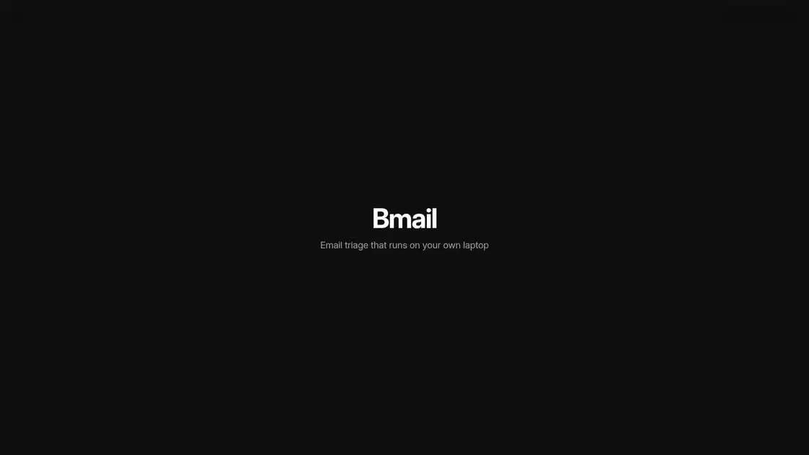

# Bmail

**A local-first email triage engine.** It reads your mailboxes on your own
machine, decides what actually needs you, and turns lifecycle email — job
applications, university admissions, candidate pipelines, invoices — into a live
tracker you never have to type into.

Nothing leaves your computer. No server, no account, no telemetry.

```
$ bmail ui        # a window; or `bmail brief` for the same thing in the terminal

Bmail brief · Tue 01 Sep 2026 09:12 UTC · pack: job-seeker
========================================================================
4 need you · 2 deadlines · 1 upcoming · 14 stalled · 61 archived

NEEDS YOU
 1. Online-Test für Ihre Bewerbung als Data Engineer
    Nordwind Analytics · assessment
    deadline 2026-09-06
    evidence: "Bitte schließen Sie den Test bis zum 06.09.2026 ab."
 2. Interview invitation – Platform Engineer
    Lumen Mobility · interview_invite
    Mon 14 Sep 09:00 UTC
    evidence: "We propose 14 September 2026 at 10:00 CET."

STALLED — worth one follow-up
 · Helios Robotics — Backend Developer — silent 34 days · applied
 · Weser Data GmbH — Data Engineer — silent 27 days · acknowledged
```

## See it



*Thirty seconds, silent and looping. With sound:*
**[the same cut as video](media/bmail-film-30s.mp4)**, or
**[the full 1:29](media/bmail-film.mp4)**, which also covers the command
palette, the review queue and the two densities.

Every frame is the running application against the sample corpus; nothing in it
is a mockup. All three are made by a script rather than by hand, so they can be
remade when the interface moves: see [tools/](tools/).

## Why this exists

"Too many emails" is three problems, and most tools solve one:

| Problem | What it actually is | Solved by |
|---|---|---|
| **Volume** — 100+ a day, most irrelevant | A filtering problem | Rules plus a small classifier. Cheap. |
| **Comprehension** — long threads, buried asks | A summarisation problem | A language model. |
| **State** — *"did that company ever reply?"* | A **stateful tracking** problem | Entity resolution and a state machine — not summarisation. |

Nobody solves the third one well. A spreadsheet solves it only for what you
remember to type in. That is the gap Bmail fills.

The concrete version: track 90 roles, and each generates two to six emails —
auto-acknowledgement, portal invite, assessment link, scheduling, rejection.
That is 200–500 messages of pure state change, arriving out of order, in two
languages, from ATS systems that all write differently. No human holds that. A
spreadsheet holds only what you remember to update.

## Why local is the design, not a feature

- **It removes the recurring compliance cost.** Gmail's `readonly` and `modify`
  scopes are *restricted*: an app that stores or transmits that data on servers
  needs an annual third-party security assessment. A desktop app that never
  ships mail content anywhere sidesteps it entirely.
- **GDPR.** Your inbox holds personal data about *other people* — recruiters,
  professors, candidates. Send it to a US API and you are a controller using a
  processor. Process it locally and, for personal use, there is no processor at
  all.
- **Unit economics.** Backfilling three years of mail is hundreds of thousands
  of tokens — precisely the workload cloud APIs punish. Locally it is a warm
  laptop for an hour, once.

See [docs/PRIVACY.md](docs/PRIVACY.md).

## Install

Python 3.10 or newer — the test suite is run against 3.10, 3.11, 3.12 and 3.13.
The core needs three packages (plus `tomli` on 3.10, where `tomllib` is not yet
in the standard library).

```bash
git clone https://github.com/GajjarB/Bmail.git
cd Bmail
python -m venv .venv && source .venv/bin/activate
pip install -e .
```

Optional extras: `pip install -e '.[ml]'` (trainable classifier),
`'.[html]'` (faster HTML extraction), `'.[gmail]'`, `'.[graph]'` (Outlook and
Microsoft 365), `'.[keyring]'`, `'.[embeddings]'`, or `'.[all]'`.

For Stage 3, install [Ollama](https://ollama.com) and pull the model
`bmail doctor` suggests for your hardware. **Everything except Stage 3 works
without it** — Bmail degrades to rules plus the classifier and says so.

## Try it in one minute, with no credentials

```bash
bmail init
bmail samples --out ./sample        # a synthetic EN/DE corpus with ground truth
bmail ingest --path ./sample/sample.mbox --account demo
bmail triage
bmail brief
bmail cases
```

Or open the window:

```bash
bmail ui                      # opens a browser at a loopback address
```

Then point it at real mail. Start with a file — a Gmail Takeout export or any
`.mbox` — because it needs no OAuth and no rate limits. Gmail, Outlook /
Microsoft 365 and any IMAP mailbox are configured in `config.toml`; see
[docs/PROVIDERS.md](docs/PROVIDERS.md).

```bash
bmail ingest --path ~/Downloads/takeout/Mail/All\ mail.mbox --account archive
bmail triage && bmail brief
```

## The window

`bmail ui` serves the app from the local daemon and opens it. There is also a
native shell built on Tauri, for a real desktop window and installers:

```bash
cd desktop/src-tauri && cargo build --release && ./target/release/bmail-desktop
```

Both run the same page against the same daemon. It is a briefing rather than a
dashboard: **Today** opens with a sentence — *"Eighteen things need you."* —
then the things themselves, each carrying its deadline and the quoted sentence
that proves it. **Applications** draws every case's state machine as a rail and
fills only the stages it actually reached. **Mail** is everything, searchable.
**Review** asks about one uncertain guess at a time, and each answer teaches the
classifier. Long jobs run in the background with a progress bar.

Two densities ship: **Studio**, roomier and easier to read, and **Compact**,
which fits about half again as much on a screen. Switch in Setup. Both are
driven from the keyboard — `j`/`k` move a cursor through the list, `↵` opens,
`esc` closes, `/` searches, `⌘K` reaches everything from anywhere, and `?`
lists the rest.

The page is vanilla HTML, CSS and JavaScript with no build step and no
framework: it is served from your own machine and has to work offline, so there
is nothing to fetch and nothing to compile. A test asserts it makes no external
requests at all. See [docs/UI.md](docs/UI.md) and [the film](#see-it).

## How it works

Four stages. Each may settle a message and stop; only what survives goes on.

```
Stage 1  headers, contact graph, ATS template recipes, near-duplicate collapse
           └─ resolves most of an inbox with zero model calls
Stage 2  local embeddings + a calibrated classifier
           └─ accept when confident; escalate when not, or when the miss is expensive
Stage 3  local LLM, schema-constrained, every fact carrying its source sentence
Stage 4  entity resolution + a per-pack state machine
```

Three ideas do most of the work:

**Deterministic first.** ATS systems send the same text with three fields
swapped. Fingerprint the boilerplate once and extraction becomes a regex — no
model call, milliseconds, deterministic. Run `bmail templates` on your own
corpus; that number decides how much model you actually need, and it is usually
higher than people expect.

**Asymmetric routing.** Missing an interview invitation is catastrophic; a false
alarm costs three seconds. So high-stakes categories escalate to the model
regardless of confidence, and packs declare which those are.

**Every fact shows its source.** Each extracted date arrives with the sentence
it came from, and that sentence is checked against the email. A date the email
does not contain is dropped, not displayed. This makes hallucination visible and
measurable instead of silent — the single highest-value decision in the project.

Full detail in [docs/ARCHITECTURE.md](docs/ARCHITECTURE.md).

## Domain packs

Job seekers, university applicants and recruiters are the same machine with
different vocabulary — so that is made explicit. A pack is a YAML file declaring
categories, a case key, a state machine and KPIs. The engine is domain-agnostic.

| Pack | Entity | Killer feature |
|---|---|---|
| `job-seeker` | application | Ghosting detection, ATS parsing, response-rate analytics |
| `student-admissions` | programme application | Deadline extraction (uni-assist, DAAD, portals), missing-document alerts |
| `hr-recruiter` | candidate × requisition | Response-time SLAs, candidate dedupe |
| `freelance-ops` | invoice | Amount and due-date extraction, an overdue chase list |

Write your own: [docs/PACKS.md](docs/PACKS.md).

## Outputs

SQLite is the source of truth; a spreadsheet is an export. It cannot dedupe,
cannot hold a state machine, and cannot tell you what has gone stale.

```bash
bmail export --xlsx tracker.xlsx    # Overview / Cases / Timeline / Deadlines / Contacts
bmail export --ics deadlines.ics    # interviews as events, deadlines with alarms
bmail export --csv ./out
bmail labels                        # plan provider labels — writes nothing outward
bmail notion --database <id>        # fill a Notion database you already have
```

## Evaluation

Built in from the start, because trust is the product.

```bash
bmail eval labels.jsonl --ablate
```

Reports per-class P/R/F1, **recall on `action_required`** as the headline
number, precision@5 on the Brief, field-level accuracy (exact on dates including
timezone, fuzzy on organisation names), a hallucination rate, and latency —
across rules-only, +classifier, +LLM, LLM-on-everything, and German vs English
subsets. See [docs/EVALUATION.md](docs/EVALUATION.md).

## Security

Email is attacker-controlled text being fed to a model, so prompt injection is
not hypothetical:

- **The model has no tools.** It emits JSON. Every side effect happens in Python
  from validated fields.
- **The body is data, not instructions** — fenced with delimiters stripped from
  the content first.
- **Nothing is fetched.** URLs are reduced to their host before reaching a
  prompt: no tracking pixels, no SSRF.
- **Nothing auto-deletes, ever.** The only outward write is a label, and only
  after you confirm it. Worst case is a wrong row in a local database.
- Passwords go to the OS keychain, never the config file. `bmail doctor` warns if
  one ends up there.
- The local server binds `127.0.0.1` only, on a random port, behind a session
  token, with the `Host` header pinned against DNS rebinding and `Origin`
  checked on every request. The model host must be loopback unless you
  explicitly opt out.
- The daemon never outlives its window: the shell kills it on close, and the
  daemon also watches its parent and stops when that goes away.

## Commands

| Command | What it does |
|---|---|
| `bmail init` | Create the config and the store |
| `bmail doctor` | Check the environment, models and privacy settings |
| `bmail samples` | Generate a synthetic corpus with ground truth |
| `bmail ingest` | Pull mail from a file, IMAP or Gmail |
| `bmail triage` | Run the pipeline |
| `bmail brief` | What needs you, in one screen (`--format md\|json`) |
| `bmail cases` | The tracker (`--id N` for a full timeline) |
| `bmail review` | Confirm low-confidence verdicts; each answer trains the classifier |
| `bmail templates` | Recipe coverage over your own corpus |
| `bmail search` | Full-text search |
| `bmail export` | Excel, CSV, calendar |
| `bmail labels` | Plan and apply provider labels |
| `bmail eval` | Score the pipeline; `--ablate` for the comparison |
| `bmail packs` | List and describe domain packs |
| `bmail ui` | Open the desktop UI |
| `bmail serve` | Run the local daemon without opening a browser |

The core is importable and headless — the CLI is a client of it, not a container
for it:

```python
from bmail.store.db import connect
from bmail.packs import load_pack
from bmail.classify import Classifier
from bmail.pipeline import Pipeline
from bmail.store import repo

conn = connect("~/.local/share/bmail/bmail.sqlite3")
pack = load_pack("job-seeker")
stats = Pipeline(pack, classifier=Classifier(pack), use_llm=False).triage(
    conn, repo.iter_messages(conn, limit=200)
)
```

## Status and what is deliberately absent

Working today: file/mbox/Maildir, IMAP, Gmail and Microsoft Graph ingest, all
four stages, four packs, 50 starter template recipes, the Brief, cases and
ghosting detection, Excel/CSV/ICS/Notion export, Gmail label and Outlook
category write-back, the evaluation harness and ablations, the local daemon,
and the desktop UI in both browser and native-window form.

Not built yet: `sqlite-vec` embedding storage, and signed installers — signing
needs per-developer Apple and Windows certificates that cannot live in a repo.

Not planned: **compose and send.** The moment Bmail becomes a mail client the
project doubles — rendering, offline sync, threading, MIME edge cases. Bmail sits
*beside* your mail client and writes back only labels and categories.

## Development

```bash
pip install -e '.[dev,ml,html]'
pytest -q                  # 207 tests
ruff check src tests

# The browser tests drive the real UI in Chromium; they skip if it is absent.
pip install playwright && playwright install chromium

# The native shell (needs Rust, and WebKitGTK on Linux)
cd desktop/src-tauri && cargo build --release
```

## Licence

MIT. See [LICENSE](LICENSE).

The interface bundles two third-party assets, both free to use and redistribute,
each shipped with its licence beside it:

- **[Inter](https://rsms.me/inter/)** by Rasmus Andersson, under the SIL Open
  Font License 1.1 — `src/bmail/ui/static/fonts/LICENSE-Inter.txt`.
- **[Lucide](https://lucide.dev)** icons, under the ISC licence —
  `src/bmail/ui/static/icons.LICENSE.txt`.

Both are served from your machine; the interface fetches nothing from the
network.
